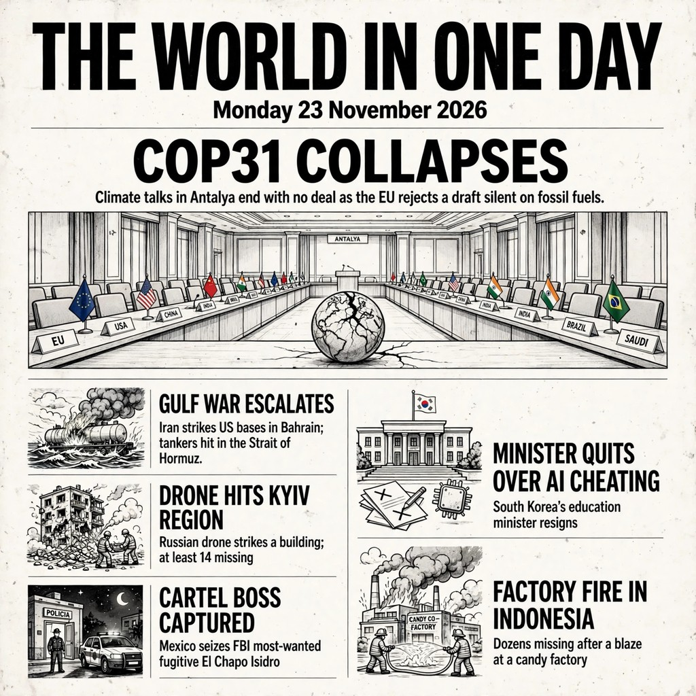

# The World in One Day — 23 November 2026

[](https://make.fun/bounty/news-image-20261123?utm_source=github&utm_medium=readme&utm_campaign=news-image-20261123)
[](https://make.fun/bounty/news-image-20261123/leaderboard?utm_source=github&utm_medium=readme&utm_campaign=news-image-20261123)
[](https://make.fun/bounty/news-image-20261123?utm_source=github&utm_medium=readme&utm_campaign=news-image-20261123)

A make.fun entry for **news-image-20261123**: one image that sums up the
world news of Monday 23 November 2026.



## The day's stories

1. **COP31 collapses** — The UN climate talks in Antalya end with no deal
   after the EU and others reject a final draft silent on fossil fuels;
   the longest COP on record closes without an overarching agreement.
2. **Gulf war escalates** — Iran strikes US bases in Bahrain and tankers
   in the Strait of Hormuz; about 25 tankers have been hit in and around
   the strait in a week.
3. **Drone hits Kyiv region** — A Russian drone strikes a building in the
   Kyiv region; at least 14 people are missing.
4. **Cartel boss captured** — Mexico seizes 'El Chapo Isidro', an FBI
   most-wanted fugitive, in Sinaloa.
5. **Minister quits over AI cheating** — South Korea's education minister
   resigns amid an AI exam-cheating scandal.
6. **Factory fire in Indonesia** — Dozens are missing after a blaze at a
   candy factory.

## How it works

`main.ts` (Node 22, standard library only) copies `entry.png` — a
1024×1024 JPEG under 1 MiB — to `$MAKEFUN_OUTPUT_DIR/entry.png`
(`/output` in the grader). The program is fully deterministic: both
graded runs write byte-identical output.

Run locally:

```sh
mkdir -p out && MAKEFUN_OUTPUT_DIR=out node main.ts
```

## Sources

Stories were verified against the day's reporting (Reuters, AP, Al
Jazeera and others, 22–23 November 2026). The lead is the COP31 collapse
and the reactions to it on Monday 23 November 2026; the other stories are
the day's news as reported on 23 November 2026 — all events from 22–23
November 2026, nothing before 13 November 2026 appears.

## License

MIT — see [LICENSE](LICENSE).
